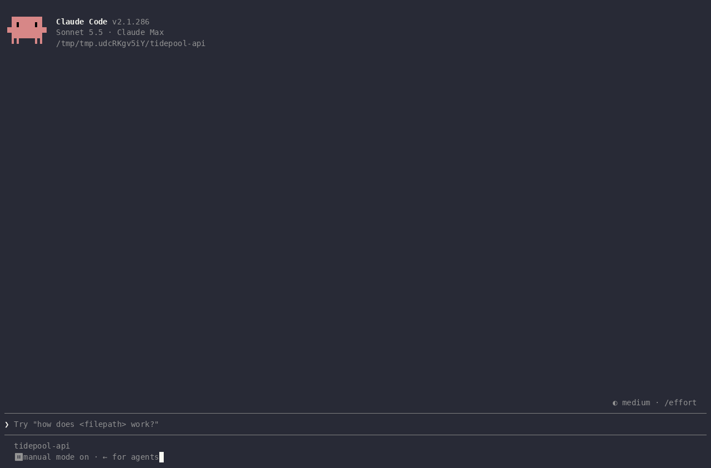

# session-decisions

**A queue for everything your assistant is waiting on you for.** Questions an assistant asks get
buried in long messages and scroll away; this plugin pins each one as a numbered card (`D1` for a
decision, `A1` for something only you can do) in the transcript, a sidebar and the footer, with a
recommendation you can accept in one click.



That's a real session, sped up while the assistant works. I asked Claude to plan moving a small Flask
service from SQLite to Postgres without writing any code. It queued its questions as tasks, shown
as cards in the sidebar, each with the answer it recommends. One click on Accept all put an answer
line for every recommendation in my prompt, and one Enter settled them. What's left are the two
things only I can do: tell it where the database lives, and hand over a sample of the data.

## Install

```bash
claude plugin marketplace add lokkju/skills
claude plugin install session-decisions@lokkju
```

Restart Claude Code. There's nothing you have to configure; the skill tells the assistant when to
queue something, and the hook keeps it honest. There are two options:
[`forge_hosts`](#forge-hosts) is for repositories on a self-hosted forge, and
[`handoff_check`](#hand-off-check) turns off the check for work handed to you outside the queue.

## How it works

### Asking

The assistant creates an ordinary task with a subject in one of two forms:

| Kind | Subject | Becomes |
| --- | --- | --- |
| Decision | `DECIDE: Postgres driver? (recommend psycopg 3) [#12]` | `D3 DECIDE: Postgres driver? (recommend psycopg 3) [#12]` |
| Action | `ACTION: Provision the target database [no link]` | `A2 ACTION: Provision the target database [no link]` |

A hook on TaskCreate assigns the label and refuses a decision with no recommendation, or any item
with no link, telling the assistant what's missing. The link is an issue (`#123`,
`owner/repo#123`), a merge or pull request (`!45`), a URL, or `no link`. An assistant that can't
write a recommendation isn't ready to ask yet, which is the point.

### Seeing

- **Transcript:** the row where the assistant asked becomes the item's card, and shrinks to
  `✓ D3 · <ruling>` once it's settled. Claude Code folds a TaskCreate call into a group with the
  calls around it, which draws nothing on the main view, so the card draws in that group's place;
  this works the same at any terminal size, in fullscreen and on the main screen.
- **Sidebar:** in fullscreen, the first new item opens the queue beside the transcript (Claude
  Code only seats a pane it wasn't asked for from 144 columns). Close it and it stays closed
  until the queue empties, and then closes itself.
- **Footer:** while anything is open, `● 5 decisions` sits beside the mode labels. Click it to
  open the queue; Esc closes it.
- **Cards:** a `DECIDE` or `ACTION` chip, the label, a `recommends <choice>` tag, the question
  with any qualifier under it, the link, and the item's age, which turns red after a day. An item
  the assistant revised after asking (its description has a `Revised (<date>): ...` line) shows
  `revised <date>`, so a changed recommendation doesn't slip past you. The assistant revises with
  TaskUpdate, or with the plugin's `decision_update` tool for an item it added without the task
  tools. The question and qualifier draw as markdown; one-line rows, chips and toasts show it as
  plain text.
- **Links:** a short link (`#12`, `!45`, `owner/repo#12`, or `no link`) sits at the right end of
  the button row. A URL gets a line of its own under the question, as a clickable link: a GitHub
  issue or pull request reads `owner/repo#12` and a GitHub repository `owner/repo`; any other URL
  is shown whole and wraps instead of being cut off. A plain `http:` URL other than localhost
  can't be a clickable link in Claude Code, so it's shown as dim text. When the session's
  repository has a remote on a forge the plugin can name, the short link and any `#12`, `!45` or
  `owner/repo#12` in the question are clickable too, pointing at that forge: `#12` an issue
  (GitHub and Forgejo send it on to a pull request with that number), `!45` a pull or merge
  request. It reads `origin` (or the only remote) once, at session start, and knows github.com,
  gitlab.com, codeberg.org, and hosts named `gitlab.*`, `forgejo.*` or `gitea.*`. A self-hosted
  forge's kind can't be told from any other name, so on any other host the references stay text
  unless [`forge_hosts`](#forge-hosts) names it. A repository whose remote is an SSH alias, a
  mirror, or otherwise not where its issues live can say where they do in its
  [git config](#per-repository-forge). On the terminal a link is an OSC 8 hyperlink, which most terminals open with a click (or
  ctrl/cmd+click); one without OSC 8 support shows the text alone.
- **More:** when the details view has something the card doesn't (a description, a link it
  spells out as a URL and can copy, a command in backticks it can copy, or a recommendation the
  card cuts short), the card's text ends with a dim `[more]`: after the question, or after the
  qualifier when there is one, on its last row when there's room and on a row of its own when the
  text fills it. A card without `[more]` is the whole item. `[more]`, or a press on the card's
  label, shows the item in full in the queue pane, in place of the list; from a transcript card
  the pane opens for it, with the keys, at any terminal width. The view has the card's top row
  with a `↑↓ PgUp PgDn scroll · Esc closes` hint, then its buttons: **Accept** for a decision or
  **Done** for an action, **Answer**, **Copy link** when the link is a URL or a reference the
  plugin can resolve, **Copy <command>** for the first command in backticks, and **Back** to the
  list (**Close** when the pane opened just for this item). Under them come the question, the
  link, `Recommended: <the full recommendation>` and the whole description, drawn as markdown
  (lists, tables and code blocks included), ending in a dim `─ end of D3 ─` line so you can tell
  you've reached the bottom. Nothing is cut: the pane scrolls with the arrows, PgUp and PgDn, Home
  and End, and the mouse wheel, and Tab walks the buttons wherever the view is scrolled to.
  Accept, Done and Answer fill the prompt as the card's buttons do and leave the view; copying
  works on the terminal, and Claude Code has no clipboard path for the other surfaces yet. Esc
  closes the pane and changes nothing.
- **Task list:** where the session has TaskCreate, the items are tasks, so ctrl+t lists them too.

### Answering

**Accept** puts `D3: go with <the recommendation>` in your prompt, **Done** puts `A2: done`, and
**Answer** puts `D3: ` for you to finish. The details view `[more]` opens fills the same lines. Each press adds or replaces that item's line, so one
message can answer several items; **Accept all** adds a line for every open recommendation. You
edit and send it like any other message, and the assistant marks each item completed with a
dated `Ruling (2026-10-08): ...` line. Completed items stay in the task list as the session's
record; `Settled (n)` in the sidebar shows them.

### Commands

| Command | What it does |
| --- | --- |
| `/decisions` | Lists the open items |
| `/decisions all` | Adds the settled ones, with their rulings |
| `/decisions pane` | Opens the sidebar |
| `/decisions wrap` | Has the assistant settle every open item before the session ends: escalate it to the tracker, carry it into the handoff, or drop it |

### After compaction

When a session is compacted or resumed, the assistant is reminded of what's still open, so a
question asked two hours ago doesn't silently fall out of context.

Labels are session-scoped. Anything recorded outside the session (commits, issues, pull
requests) carries the ruling and its date, never `D3`, which means nothing anywhere else.

### Hand-off check

The skill tells the assistant to queue every step only you can do, but the slip comes at the end
of a long reply: a "Left for you:" list (merge these PRs, run this on each host) with none of it
queued. When a reply ends, the plugin reads it for work handed to you that isn't in the queue. If
it finds any, a toast names the first line (`2 hand-offs not queued: Merge #41 and #42`), and with
your next message the assistant is told which lines they were and to queue whatever is still
waiting on you. It never blocks or rewrites the reply, and costs no extra
model call.

It looks for three things:

- the list items under a hand-off heading (`Left for you:`, `Next steps for you:`, `You'll need
  to:`, `## What you need to do`);
- a line that hands a step over by itself (`You'll need to merge it once CI passes`, `left for
  you`, `your call`, `please merge #12`, `run these on each host`), including the user-only steps
  an assistant tends to leave in prose because they never block its own work: `the only thing
  blocking the build restart`, `I cannot write to Vault for you`, `I don't have access to the
  registry`, `say the word and I'll push`, `approve the SSH key prompt`, `put the client secret in
  Vault`, `the push needs your approval`;
- a label the reply names that isn't in the session's queue (`A24 is in the queue for that`, with
  no A24), which means the item was never created. The toast says so (`A24 named but not in the
  queue`), and the reminder tells the assistant to create it.

To keep false alarms rare, it skips:

- a line that names a label in the queue (`A3: rotate the key`), or that an item already covers:
  an open item, or one queued this turn, that shares a reference (`#41`, `!4`, a URL) with it, or
  most of its words;
- conditional, negated and questioning phrasing (`if you need to roll back`, `you won't need to`,
  `will you need to review it first?`);
- code blocks, quoted lines, and a phrase inside quotes or backticks;
- a sentence about what another agent, a document or a tool will produce (`It'll lay out the
  options and the questions only you can answer`, `The report lists the steps you'll need to
  run`), and `only you can answer` or `decide` with nothing after it;
- a line about the check itself, such as a note that it raised a false alarm;
- a heading that's really a sentence (`For you to compare, the two plans are:`), and a bare `Next
  steps:`, which is usually the assistant's own plan.

It reads the main conversation's replies, not a subagent's, and stays quiet while a Stop hook has
the assistant continuing. Set `handoff_check` to `false` (in `/config`, or under `options` as in
[Forge hosts](#forge-hosts)) to turn it off.

### Forge hosts

`forge_hosts` tells the plugin what kind of forge a host runs, for the ones it can't name itself:
`host=kind` entries split by commas, where the kind is `github`, `gitlab`, `forgejo` or `gitea`
(Gitea links the same way Forgejo does). For example:

```text
git.lab.example.com=forgejo, code.example.com=gitlab
```

With that set, a repository whose `origin` is `ssh://git@git.lab.example.com/me/demo.git` links
`#12` to `https://git.lab.example.com/me/demo/issues/12` and `!4` to `.../pulls/4`. An entry
wins over the built-in rules for its host, so `gitlab.example.com=forgejo` corrects a host whose
name says the wrong thing. GitLab paths keep their subgroups (`group/sub/proj/-/issues/12`).

Set it in `/config` (search for "Forge hosts"), or in `~/.claude/settings.json`:

```json
{
  "pluginConfigs": {
    "session-decisions@lokkju": { "options": { "forge_hosts": "git.lab.example.com=forgejo" } }
  }
}
```

The plugin reads the remote at session start, so a change applies from the next session. An
entry it can't use (no `=`, a URL instead of a host name, an unknown kind) is skipped, and a toast
at session start names it; the other entries still apply.

### Per-repository forge

`forge_hosts` maps a host to one kind of forge for every repository. Some repositories need their
own answer: the remote is an SSH host alias (`homelab-git:lokkju/demo.git`) whose name doesn't
resolve on the web, the remote is a mirror or a push-only URL and the issues live on another
forge, or the SSH host isn't the web host (`ssh.git.lab.example.com` against
`git.lab.example.com`). Two git config keys in the clone say where its references link to, and
win over `forge_hosts` and the built-in rules:

| Key | Value |
| --- | --- |
| `tracker.web` | The repository's web URL, `https://` only: `https://git.lab.lokkju.com/lokkju/demo`. |
| `tracker.forge` | `github`, `gitlab`, `forgejo` or `gitea`. |

```bash
git config tracker.forge forgejo
git config tracker.web https://git.lab.lokkju.com/lokkju/demo
```

With both set, `#12` links to `https://git.lab.lokkju.com/lokkju/demo/issues/12` and `!4` to
`.../pulls/4`, whatever `origin` says; the remote isn't read at all. Either key works alone:

- `tracker.web` alone takes the kind from its host, as `forge_hosts` and the built-in rules name
  it, so `git config tracker.web https://github.com/acme/tracker` is enough for a mirror whose
  issues are on GitHub.
- `tracker.forge` alone keeps the remote's host and path and names its kind, for a host
  `forge_hosts` doesn't list when you'd rather not name it for every repository.

A forge under a subpath works for GitHub and Forgejo, whose repositories are always the last two
segments: `https://code.example.org/forge/me/tool` links `#12` to
`https://code.example.org/forge/me/tool/issues/12` and `other/repo#7` to
`https://code.example.org/forge/other/repo/issues/7`. GitLab's groups nest, so its whole path is
the project and the instance is taken to sit at the host's root; `#12` and `!4` link correctly
under a subpath, but `group/project#7` will miss the subpath.

The keys are ordinary git config, so they're per clone (`.git/config`) and never committed. That
suits an SSH alias, which belongs to one machine's `~/.ssh/config`. To set them for every clone
that uses an alias, put them in a file that `~/.gitconfig` includes for remotes with that alias
(git 2.36 or later), which works for `tracker.forge`; `tracker.web` names one repository, so it
belongs in each clone:

```ini
[includeIf "hasconfig:remote.*.url:homelab-git:*/**"]
    path = ~/.config/git/homelab.gitconfig
```

The names aren't this plugin's own: forge-tracker answers the same question for its reports, and
the `tracker.*` keys are meant for both. The plugin reads them at session start, with the remote,
so a change applies from the next session. A value it can't use (an unknown kind, a URL that
isn't `https://` or has fewer than two path segments) is skipped, a toast at session start names
it, and the plugin carries on as if that key weren't set.

## Requirements

Claude Code with function hooks, which interactive sessions and background jobs load. A plain
`claude -p` run doesn't load them unless `CLAUDE_CODE_ENABLE_FUNCTION_HOOKS=1` is set; there the
skill tells the assistant to number items itself.

Not every session gets TaskCreate. For models newer than Claude 4.x, Claude Code turns the task
tools on only for background jobs, a launch tool list that names them, or
`CLAUDE_CODE_ENABLE_TODO_TOOLS` ([#4](https://github.com/lokkju/skills/issues/4)). Since Claude Code
2.1.300 the `haiku` alias is Haiku 5.5 on the Anthropic API, so this covers haiku as well. To get them in an
ordinary session, set it in `~/.claude/settings.json`:

```json
{ "env": { "CLAUDE_CODE_ENABLE_TODO_TOOLS": "1" } }
```

Without them, the assistant uses the plugin's `decision_add` and `decision_close` tools instead. The items show the
same way in the cards, the sidebar, the footer and `/decisions`; only `/decisions` tags them
`ledger`, since that's the one difference you'd notice: they don't appear in ctrl+t.

A background subagent (`Agent` with `run_in_background`) never gets the task tools, even in a
session that has them. Its items go through `decision_add` into the session's one queue, numbered
after the main conversation's, so a subagent's item can be D2 after your D1; they show everywhere
but ctrl+t, which lists the main conversation's D1 and not the subagent's D2. When a background
subagent settles one of the main conversation's task-list items, `decision_close` settles it in
the queue, as it does after a restart that drops the task tools. A foreground subagent has the task
tools, and its items land in the main task list with the same labels.

With `NO_COLOR` set or `TERM=dumb`, chips and glyphs fall back to ASCII (`[DECIDE]`, `+`, `x`).
Otherwise the cards use Claude Code's theme colors and follow your theme.

## How it stays in sync

The plugin never polls. It keeps the items in the session's plugin state and updates them from
TaskCreate and TaskUpdate calls as they finish; the footer, sidebar and cards redraw from that
state. It reads the task files once, at session start and after compaction or resume, to pick up
items it didn't see created, and merges them with the items it already holds and the ones in its
store rather than replacing them.

Label counters, creation times, the fallback ledger and the rulings `decision_close` keeps for
task-list items are stored as one record in the plugin's store, so a session picks up its
numbering and ledger again whatever happens to its id:

- `claude --resume`, `--continue` and compaction keep the session id and its task list, and the
  record is the session's.
- With `CLAUDE_CODE_TASK_LIST_ID` set, the record is keyed by that task list instead, so a session
  that comes back under a new id on the same list finds it. A record kept under the session id
  before the list was named moves under the list the first time it's read. Sessions sharing the
  list write the one record, keeping each other's ledger items and the higher counters.
- Backgrounding a session forks it: the job gets a new session id and a copy of the task files.
  A session with no record of its own whose task files hold decision items starts from the record
  of the session those files came from, found by matching task ids and labels.
- Any session that comes back under a new id with its conversation (a restart that resumes it
  under a new id, a backgrounded job, `--fork-session`) and has no record of its own also looks at
  its transcript: what `decision_add`, `decision_update` and `decision_close` answered there names
  the ledger items it had. It starts from the record whose ledger holds every one of them by
  label, at least one word for word, and closed wherever the transcript closed it; when it also
  has task files, that record's task list has to match them too. That's how a session whose items
  are all in the ledger finds its record, and an unrelated session in the same project, whose
  transcript never had those answers, is never taken for it.
- Labels the transcript shows, from the ledger or from TaskCreate, are never handed out again,
  even when no record is found.
- `--fork-session` gives a new id and an empty task list: its ledger items carry over through the
  transcript, its task-list items don't.

The task tools can come and go within one session: a restart or resume can drop them, and
`CLAUDE_CODE_ENABLE_TODO_TOOLS` brings them back. Items added with `decision_add` while they were
missing stay ledger items when they return, and `decision_close` still settles them. A task-list
item asked before the tools went away can't be updated with TaskUpdate, so `decision_close`
settles it instead: the plugin marks it completed with the ruling in its own state and store, and
keeps it settled when it re-reads a task file that still shows it open. While TaskUpdate is
offered, `decision_close` refuses task-list items and points the assistant at TaskUpdate, and a
status TaskUpdate sets replaces the plugin's ruling.

On VS Code and mobile there's no footer count (Claude Code only raises the footer on the terminal
and desktop); the transcript cards, the sidebar and `/decisions` work everywhere.

## Limits

- The task files are read from `~/.claude/tasks/<session id>/`, which Claude Code doesn't
  document. If that changes, items created before a resume or compaction stop showing until
  they're updated; labelling is unaffected.
- Two sessions sharing a task list (`CLAUDE_CODE_TASK_LIST_ID`) don't see each other's changes
  until their next session start. They share one stored record, but each numbers from what it
  holds, so items the two create in that time can get the same label. Rulings `decision_close`
  keeps for task-list items are written as the last session to write holds them.
- `decision_close` and `decision_update` decide whether the main conversation has TaskUpdate from
  `$.tool.list()`. On Claude Code 2.1.300 that list names a deferred tool before the model loads
  it through ToolSearch, so a task-list item is sent to TaskUpdate whenever the session has it;
  the engine's declarations don't promise that. If a later build lists only loaded tools,
  `decision_close` would settle a task-list item in the queue while its task file stays open.
- Inside a subagent, `$.tool.list()` still answers the main conversation's tools, and no hook
  lists a subagent's own. So the plugin judges a subagent by what it saw: one spawned in the
  foreground has what the main conversation has, one that has called a task tool has them, and
  any other (spawned in the background, a teammate, a workflow's agent, or one spawned before the
  plugin loaded) is taken to have no TaskUpdate, so `decision_close` settles its task-list items
  in the queue. A teammate that does have TaskUpdate and calls `decision_close` before any task
  tool leaves its task file showing the item open.
- A session under a new id is matched to the one it came from by the task files Claude Code
  copies into it, which it doesn't document either, and by its transcript as
  `$.session.messages()` reads it (the newest 4096 messages). One whose task files hold no
  decision items and whose transcript no longer shows any ledger answer (a compaction summarised
  them away before the id changed, say) has nothing to match and starts a fresh queue. The
  earlier session's record has to be among the 100 most recently used ones the store keeps.
- A forked session takes a copy of its parent's record. Ledger items either one adds or settles
  afterwards stay in that session.
- A task-list item settled with `decision_close` stays open in its task file, so ctrl+t still
  lists it as pending until something marks it completed with TaskUpdate. The cards, the sidebar,
  `/decisions` and the reminder after compaction all show it settled.
- Whether the main conversation has TaskUpdate comes from the session's tool list. A host that
  can't list its tools is treated as not offering it, so `decision_close` settles task-list items
  there too.
- ctrl+t is Claude Code's own task list, which a plugin can't add to, so items added with
  `decision_add` (no task tools in the session) never appear there. Everything else this plugin
  draws shows them.
- Function hooks are early access and their API can change between Claude Code releases.

## Development

```bash
claude plugin validate --strict plugins/session-decisions
claude plugin test plugins/session-decisions
```

For an editor or `tsc`, run `/plugin-types plugins/session-decisions/.claude/types` in Claude Code
to write the engine's declarations for your build (git ignores them), then
`npx -p typescript@5 tsc -p plugins/session-decisions/tsconfig.json`.

### Re-recording the demo

`docs/record-demo.sh` drives a real session in a 150x42 tmux pane: it types the prompt, waits for
the assistant, clicks Accept all, sends the answers, and renders the capture with
[agg](https://github.com/asciinema/agg). It needs `tmux`, `jq`, `claude` and `agg` on PATH and
spends one short Sonnet conversation.

```bash
bash plugins/session-decisions/docs/record-demo.sh   # writes docs/demo.gif
```

The recorder opts its session into the task tools with `CLAUDE_CODE_ENABLE_TODO_TOOLS=1`, and its last
line says whether the session queued its items with TaskCreate or fell back to the ledger.
`DEMO_MODEL` picks the model the recorded session runs on.
